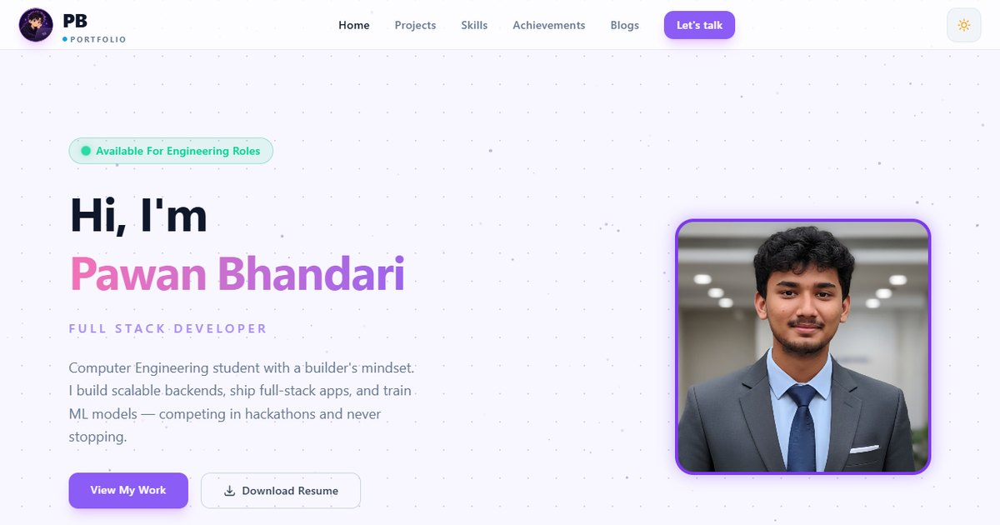

<div align="center">

# Pawan Bhandari

**Full stack developer from Pune. 3x hackathon winner.**

[**pawanbhandari.cv**](https://www.pawanbhandari.cv) &nbsp;·&nbsp; [Achievements](https://www.pawanbhandari.cv/achievements) &nbsp;·&nbsp; [Blog](https://www.pawanbhandari.cv/blog) &nbsp;·&nbsp; [LinkedIn](https://www.linkedin.com/in/pawan-singh-bhandari-5817ab307)


<br />

<a href="https://www.pawanbhandari.cv">
  
</a>

</div>

<br />

## About

This is the source of my personal portfolio. It shows the projects I have built, the hackathons I have won, the build logs I have written, and the ways to get in touch.

## What is on the site

- **Projects:** a set of featured projects, each with a short story covering the problem, the solution, the features and the outcome.
- **Skills:** the languages, frameworks and tools I work with.
- **Achievements:** hackathon wins and certifications, with the certificates.
- **Blog:** build logs and hackathon write-ups, with a reading progress bar.
- **Guestbook:** visitors can leave a message, stored in Firebase Firestore.
- **Contact:** a message form that sends email through EmailJS.
- **Chat assistant:** a small chatbot that answers common questions about me.
- **Light and dark themes:** light by default, with a toggle for dark.

## Built with

| Area | Tools |
| --- | --- |
| UI | React 19, TypeScript, Tailwind CSS v4 |
| Build | Vite |
| Motion and 3D | Framer Motion, Three.js with React Three Fiber |
| Backend services | Firebase Firestore, Supabase, EmailJS |
| Hosting | Vercel |

## Run it locally

```bash
git clone https://github.com/PawanBhandari03/Portfolio.git
cd Portfolio
npm install
npm run dev
```

Then open the address Vite prints, usually `http://localhost:5173`.

Other scripts:

```bash
npm run build     # type-check and build for production
npm run preview   # serve the production build locally
```

### Environment variables

Features that talk to outside services need keys in a `.env.local` file at the project root. Without them the site still runs, but the guestbook and the contact form will not work.

```bash
VITE_FIREBASE_API_KEY=
VITE_FIREBASE_AUTH_DOMAIN=
VITE_FIREBASE_PROJECT_ID=
VITE_FIREBASE_STORAGE_BUCKET=
VITE_FIREBASE_MESSAGING_SENDER_ID=
VITE_FIREBASE_APP_ID=
VITE_FIREBASE_MEASUREMENT_ID=
VITE_SUPABASE_URL=
VITE_SUPABASE_ANON_KEY=
VITE_EMAILJS_SERVICE_ID=
VITE_EMAILJS_TEMPLATE_ID=
VITE_EMAILJS_PUBLIC_KEY=
VITE_ADMIN_PASSWORD=
```

The guestbook only works on the deployed domain, because the Firebase setup allows that origin.

## Project structure

```text
public/               static files: robots.txt, sitemap.xml, favicons, share image
src/
  App.tsx             page routing, navbar, theme and per-page titles
  components/         hero, about, skills, projects, achievements, blog, guestbook, contact
  components/blog/    the blog articles
  assets/             project and blog images
index.html            page metadata, share tags and structured data
vercel.json           sends every route to the single page app
```

The site is a single page app with its own small router. The routes are `/`, `/achievements`, `/blog` and `/blog/<slug>`, and `vercel.json` rewrites them all to `index.html`.

## Search and sharing

- `public/sitemap.xml` and `public/robots.txt` help search engines find every page.
- Each page sets its own title, description and canonical link.
- `index.html` carries Open Graph and Twitter tags and structured data that describes me as a person.

## Deployment

Every push to `main` is built and deployed by Vercel to [www.pawanbhandari.cv](https://www.pawanbhandari.cv).

## Contact

- Website: [www.pawanbhandari.cv](https://www.pawanbhandari.cv)
- GitHub: [@PawanBhandari03](https://github.com/PawanBhandari03)
- LinkedIn: [Pawan Singh Bhandari](https://www.linkedin.com/in/pawan-singh-bhandari-5817ab307)

---

<div align="center">

Designed and built by Pawan Bhandari.

</div>
